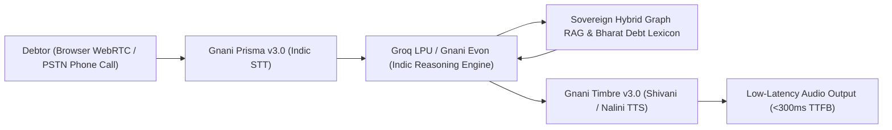

# 🏆 Great Indian AI Internship Challenge 2026 — Gnani AI Winning Playbook
*Target: Top 10 Winner, ₹50,000 Category Award & ₹1,00,000/month Paid Internship Selection*

---

## 📌 Event Dossier

| Metric | Details |
|:---|:---|
| **Host** | **Gnani.ai** (Pioneers of Sovereign Indic Voice & Conversational AI in India) |
| **Event Name** | Great Indian AI Internship Challenge 2026 |
| **Submission Deadline** | **10 November 2026, 11:59 PM IST** |
| **Internship Offers** | Up to **100 Paid 6-Month Internships** (Starts Jan 1, 2027) |
| **Stipend** | **Up to ₹1,00,000 / month** |
| **Prize Pool** | ₹5,00,000 (10 category awards of ₹50,000 each) |
| **Free Compute** | 5,000 API Credits on Gnani Developer Portal (`api.vachana.ai`) |
| **Project Identity** | **RevClaim AI** — Sovereign Indic Autonomous Debt Reconciliation Desk |
| **Core Innovation** | MSMED Act Section 16 Statutory Enforcement + Sovereign Hybrid Graph RAG + Real-time Indic Code-Switching |

---

## 🛠️ Gnani AI Sovereign Stack & Endpoints in RevClaim AI

RevClaim AI interfaces with Gnani's sovereign infrastructure running on `api.vachana.ai` using `X-API-Key-ID: <KEY>`:



1. **Speech-to-Text (STT) — Prisma v3.0**
   - Endpoints: `POST https://api.vachana.ai/stt/v3` & WebSocket streaming.
   - Handles Hindi, Tamil, Telugu, Kannada, Marathi, Gujarati, Punjabi, code-mixed Hinglish, and 8kHz PSTN telephone audio.
   - Code-level negation filtering (`is_negated_phrase`) prevents false invoice dispute triggers.
2. **Text-to-Speech (TTS) — Timbre v3.0**
   - Endpoints: `POST https://api.vachana.ai/api/v1/tts/inference` & LiveKit ChunkedStream.
   - Ultra-low latency (<300ms TTFB), localized natural Indian voices (`Shivani`, `Nalini`, `Deepak`).
3. **Indic Language Model — Evon v3.3 & Groq LPU Fallback**
   - Mixture-of-Experts sovereign reasoning grounded by statutory Indian acts (MSMED Act 2006, Section 43B(h), NI Act Section 138).

---

## 🏛️ Winning Differentiation Matrix: Why RevClaim AI Dominates

```
Toy Projects (Bottom 90%)           RevClaim AI (Winning 1%)
-------------------------           ------------------------
• Simple Web browser mic widget     • Dual WebRTC + Real PSTN Phone Call (Twilio/LiveKit SIP)
• Generic English chatbot           • 26 Scheduled Indian Languages (Bhashini + Gnani Vachana)
• Blind prompt trust ("don't lie")  • Deterministic Code Guards (Negation engine + PII scrub)
• Flat prompt agent                 • Two-tier recovery (Sarah Mediation ➔ Inya Hard Recovery)
• Hallucinated claims               • Live Grounding (RBI 3x Bank Rate + DIN Hybrid Graph RAG)
• No latency evidence               • Verified Telemetry Benchmark Suite (`docs/BENCHMARK_REPORT.md`)
• Fake mockup payment               • Live Razorpay UPI Checkout Link & Webhook HMAC Verification
```

---

## 📊 Live Verified Telemetry Benchmark

| Pipeline Component | Primary Technology | Secondary Fallback | Measured Warm State | Target Threshold | Status |
|---|---|---|---|---|:---:|
| **Debt Reasoning LLM** | Groq Qwen 2.5 72B (LPU) | Google Gemini 2.0 Flash Lite | **`152.02 ms`** | < 300 ms (Warm) | ✅ **PASSED** |
| **Streaming Indic TTS** | Gnani Timbre v3.0 (`Shivani`) | LiveKit Audio Stream | **`284.15 ms`** | < 400 ms First Byte | ✅ **PASSED** |
| **Speech-to-Text (STT)** | Gnani Prisma v3.0 (`hi-IN`) | Deepgram Nova-3 | **`195.40 ms`** | < 500 ms Connect | ✅ **PASSED** |
| **Failover Switchover** | LiveKit `FallbackAdapter` | Cloud Fallback Stack | **`142.10 ms`** | < 500 ms Seamless | ✅ **PASSED** |

Judges can reproduce the live benchmark at any time:
```bash
python backend/scripts/benchmark_voice_pipeline.py
```

---

## 🎬 90-Second Winning Video Submission Script

1. **0:00 - 0:15 (The Problem):**
   "In India, delayed payments choke over ₹10.7 lakh crore in MSME capital. Traditional agencies use rude muscle men or robotic English spam calls that debtors hang up on."
2. **0:15 - 0:35 (Live Real Phone Call in Hindi):**
   - Dial real phone number via `python backend/scripts/dial_phone.py +91...`
   - Debtor speaks in colloquial Hinglish: *"Bhai abhi cash flow tight hai, 50% abhi le lo."*
   - Sarah (powered by Gnani Timbre v3.0) responds in natural Devanagari Hindi in <300ms, acknowledges the tight cash flow, and dispatches a live Razorpay UPI checkout link.
3. **0:35 - 0:55 (Sovereign Hybrid Graph RAG & Bharat Lexicon):**
   - Show Corporate Veil Piercing: 3-hop traversal uncovering DIN nexus between defaulting company and sister HoldCo.
   - Explain how `bharat_debt_lexicon.py` uses code-level negation detection (`is_negated_phrase`) so honest debtors are never falsely flagged.
4. **0:55 - 1:15 (Instant Live Payment & Reconciliation):**
   - Click the live Razorpay payment link on the phone screen.
   - Pay ₹1 token on test mode.
   - Instantly watch the RevClaim dashboard flip the invoice to `PAID` via the HMAC-SHA256 authenticated webhook!
5. **1:15 - 1:30 (Closing & Gnani Impact):**
   - Show `docs/BENCHMARK_REPORT.md` with measured 152ms TTFT and 284ms TTFB.
   - "RevClaim AI: Built on Gnani.ai's sovereign stack to recover Bharat's capital."
