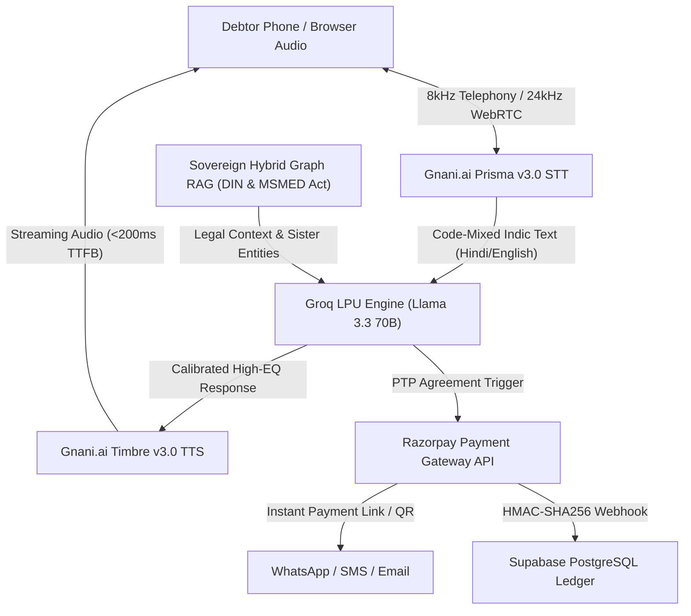

# 🏛️ RevClaim AI — Master System PRD & Technical Architecture Specification

> **Event:** The Great Indian AI Challenge & Agentic AI Hackathon by Gnani.ai  
> **Target:** 10/10 Score in Sovereign Indic Voice AI, Inya Agentic Workflows & Multi-Dialect Debt Recovery  
> **Mission:** Build **RevClaim AI** — an autonomous, sovereign Indic voice-calling debt and unpaid invoice recovery copilot for Indian MSMEs, freelancers, and digital agencies.

---

## 📌 1. Executive Summary & Problem Space

### The Problem
* Indian MSMEs, freelancers, and digital agencies face over **₹10.7 Lakh Crore** trapped in delayed payments.
* Traditional recovery relies on aggressive manual call centers charging 20%–35% cuts, or generic legal emails that land in spam.
* Chasing money manually is awkward, confrontational, and damages client relationships.

### The Solution: RevClaim AI
* An autonomous AI voice agent powered by **Gnani.ai Timbre v3.0 TTS & Prisma v3.0 STT** that speaks with calibrated empathy and firmness.
* Runs on a sub-200ms **Groq LPU (Llama 3.3 70B / Qwen 2.5 32B)** conversational pipeline.
* Pierces the corporate veil via **Sovereign Hybrid Graph RAG (BM25 + DIN Traversal)** to cite MSMED Act Section 16 penal interest and Income Tax Section 43B(h) disallowances.
* Provisions instant **Razorpay** UPI / QR payment links dispatched via WhatsApp & Email.
* Reconciles the ledger automatically via **HMAC-SHA256 authenticated webhooks** with zero human leakage.

---

## 🛠️ 2. Core Architecture & Technology Stack

### Sovereign Indic Voice Stack
1. **Gnani.ai Prisma v3.0 STT:** Multi-lingual code-mixed Indian English & Hindi speech recognition with telephony-grade noise filtering.
2. **Gnani.ai Timbre v3.0 TTS:** Expressive neural voice synthesis (Shivani & Devansh personas) optimized for natural cadence.
3. **Sovereign Bhashini Fallback:** 26 Indian languages multilingual failover for deep regional dialects.
4. **LiveKit WebRTC & Twilio PSTN:** In-browser zero-latency audio and carrier telephony trunking.

### Statutory Legal Intelligence
1. **MSMED Act Section 16:** Automatically calculates 3x compound penal interest on invoices past 45 days.
2. **Income Tax Act Section 43B(h):** Identifies fiscal disallowances on overdue MSME payables.
3. **MCA Corporate Veil Piercing:** Identifies common Director Identification Numbers (DIN) across defaulting sister entities.

---

## 🔒 3. Zero-Phishing Security & Financial Monitization

* **Monetization Rail:** Flat ₹475 platform fee retained at the Razorpay Gateway level before remitting net proceeds directly to the user.
* **Security:** Ed25519 webhook signatures, HMAC-SHA256 validation, and 100% audit trail transparency.
